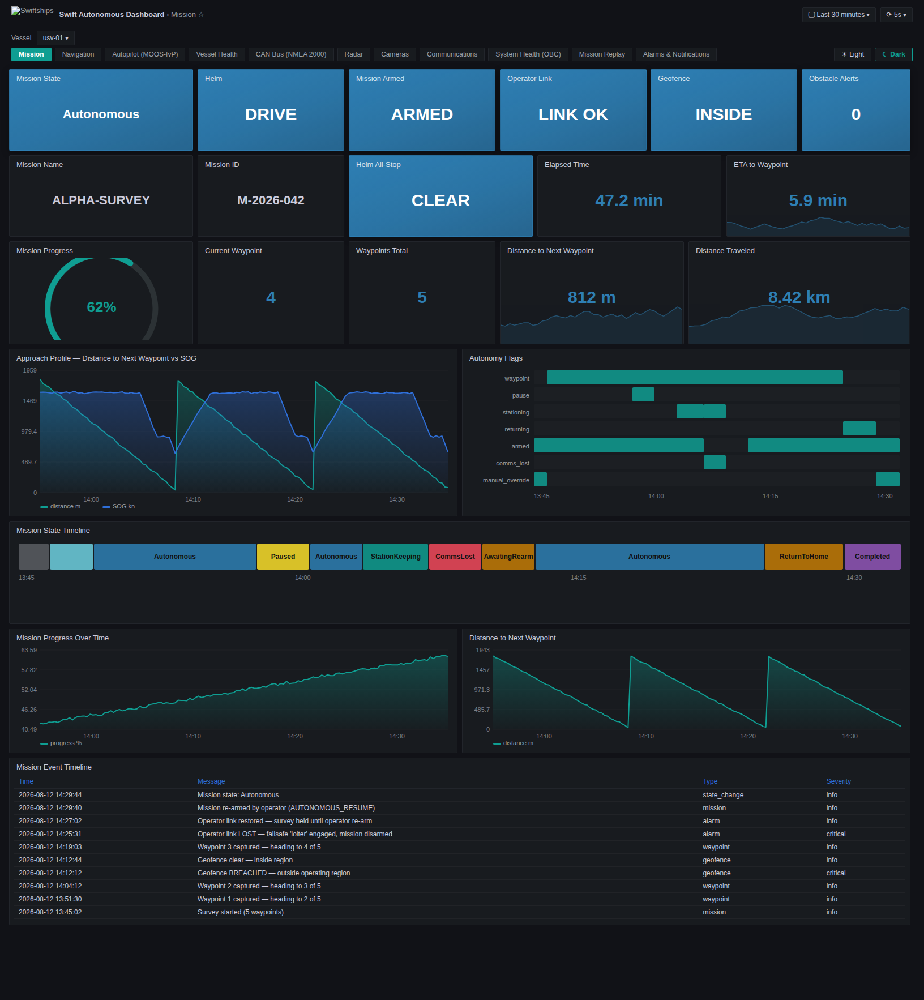
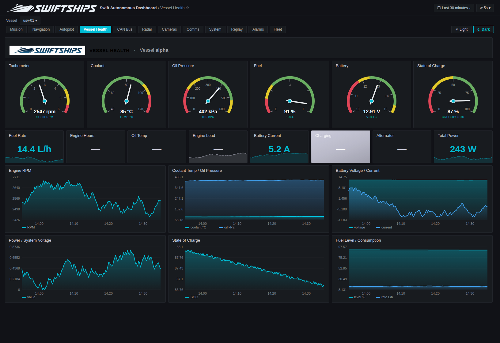
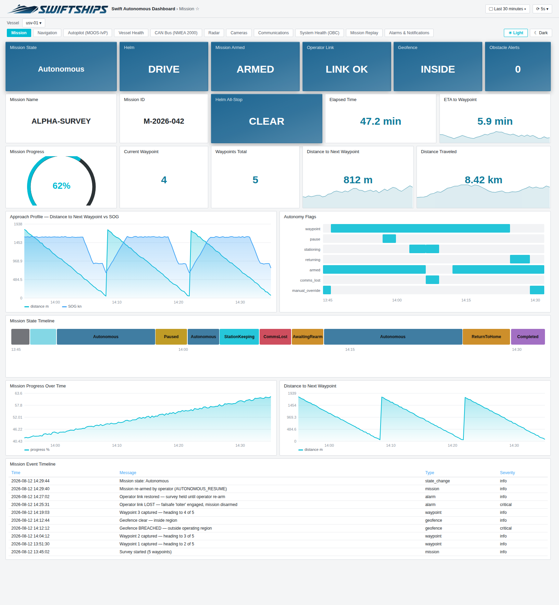
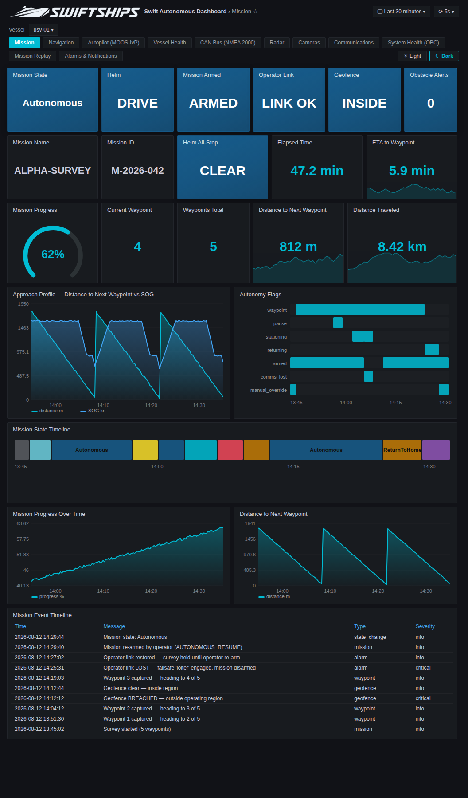

<p align="center">
  
</p>

# Swift Autonomous Dashboard

Grafana + InfluxDB monitoring stack for the Swiftships MOOS-IvP / Signal K
unmanned surface vehicle. Thirteen single-screen operator dashboards
(Mission, Readiness, Navigation, Autopilot, Vessel Health, CAN Bus,
Traffic, Cameras, Comms, System, Replay, Alarms, Fleet), 18 provisioned
alert rules and a
Swiftships-branded Grafana, fed by native C++ bridges from the MOOS
community, the Signal K server and the NMEA 2000 bus. Implements SRS
FR-1..FR-12 and is integrated with the **Alpha mission** (`alpha.bhv`): the
bridge subscribes to the mission's real variable set and derives the
operational mission state onboard (`docs/alpha-mission-integration.md`).





<table>
  <tr>
    <td></td>
    <td></td>
  </tr>
  <tr>
    <td align="center">Light theme (☀/☾ chips, or press c then t)</td>
    <td align="center">Tablet layout (responsive grid)</td>
  </tr>
</table>

## Design rules

- Nautical units only: speeds in knots, long distances in nautical miles,
  short ranges in fixed metres. Nothing on any dashboard ever scales to km.
- One screen per dashboard on a 1080p display: rows of equal 3x3 status
  tiles above instruments and trends, no scrolling during operations.
- Every dashboard carries the Swiftships header band with the dashboard
  name and the selected vessel, and works in both Grafana themes.
- Fleet-ready: every measurement is tagged `vessel`; the Fleet dashboard
  repeats a status row per vessel and maps last known positions.

## Deployment model

**Fully native, no Docker.** InfluxDB, Grafana and Telegraf run as
apt-installed systemd services on the onboard computer. All vessel-side
telemetry code is C++: `grafana_bridge` runs under pAntler as a regular MOOS
community app, `can_bridge` and `signalk_bridge` as systemd services (one
`usv-signalk-bridge@<vessel>` instance per Signal K server when several
vessels are simulated on one host).

```
deploy/
  install.sh                 # one-shot native installer (Debian/Ubuntu), idempotent
  brand.sh                   # Swiftships branding for Grafana OSS (called by install.sh)
  branding/                  # logos, favicon, wordmark chips
  usv.env.example            # -> /etc/usv/usv.env (secrets, vessel id, fleet, branding)
  systemd/                   # service units (signalk, signalk@vessel, can, simulator)
telegraf/telegraf.conf       # OBC metrics, GPU (nvidia_smi), ping, systemd units
ingestion/                   # all C++
  cpp-common/                #   async Influx line-protocol writer, HTTP GET helper,
                             #   latest-value poller (readiness inputs from other producers)
  moos-cpp/                  #   grafana_bridge (CMOOSApp) + example.moos
                             #   + mission_logic.hpp (Alpha state machine, traffic
                             #     geometry, pre-departure readiness; unit-tested)
                             #   + moos_poke utility
  can-cpp/                   #   SocketCAN / NMEA 2000 bridge
  signalk-cpp/               #   Signal K WebSocket delta bridge
simulator/                   # C++ bench generator (scripted Alpha mission)
grafana/
  provisioning/              # datasource, dashboards provider, alerting
  dashboards/*.json          # 13 generated dashboards (never edit by hand)
tools/                       # dev-side generators (Python, never on the vessel)
  gen_dashboards.py          #   regenerate dashboard JSON
  gen_alerts.py              #   regenerate alert rules (--profile sim|vessel)
  render_preview.py          #   render dashboard preview pages (dark/light)
  smoke_test.sh              #   build + unit tests + end-to-end line-protocol checks
  traffic_scenario.sh        #   scripted single-contact situations (sim host)
  fake_traffic.py            #   fake AIS / radar scene, many contacts at once (sim host)
docs/                        # schema, deployment, user guide, traceability, validation
```

## Install on the onboard computer

```bash
sudo bash deploy/install.sh     # first run creates /etc/usv/usv.env and exits
sudo nano /etc/usv/usv.env      # secrets, GRAFANA_PORT, VESSELS, branding text
sudo bash deploy/install.sh     # installs, provisions and starts everything
```

Then merge `ingestion/moos-cpp/example.moos` into the mission file
(`Run = grafana_bridge` plus its ProcessConfig). Grafana listens on
`GRAFANA_PORT` (3001 by default; the simulation host uses 3300), folder
"Swift Autonomous Dashboard". Bench test without the vessel:
`sudo systemctl start usv-simulator`.

## Development workflow

```bash
python3 tools/gen_dashboards.py          # after editing the generator
python3 tools/gen_alerts.py --profile sim
bash tools/smoke_test.sh                 # must end with FAIL: 0
```

The smoke test (82 checks) builds every C++ program, runs the
238-assertion `mission_logic_test`, drives the simulator, the CAN bridge,
the Signal K bridge and (when MOOSDB is on the PATH) the MOOS bridge
against an InfluxDB stub, and cross-checks every field the dashboards
query against what the producers actually write. All vessel-side logic
(mission state, traffic geometry and risk, pre-departure readiness) is
C++ in the bridge; Grafana only displays it. Work on feature branches, keep commits
conventional (`dashboards: ...`, `bridge: ...`, `deploy: ...`) and merge
to `main` through a pull request.

See `docs/deployment.md` for operations, `docs/user-guide.md` for
operators, `docs/schema.md` for the InfluxDB schema,
`docs/traceability.md` for requirement coverage,
`docs/validation-report.md` for what was verified and how, and
`CHANGELOG.md` for release history (baseline: v1.0.0).
